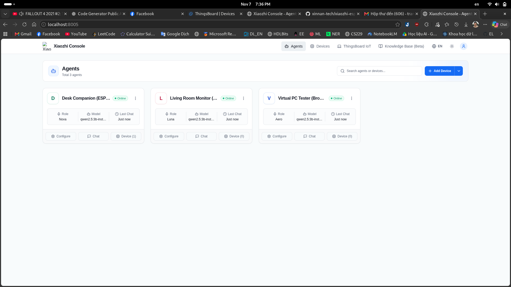
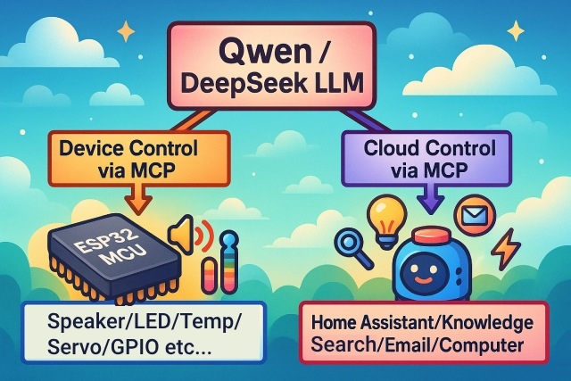
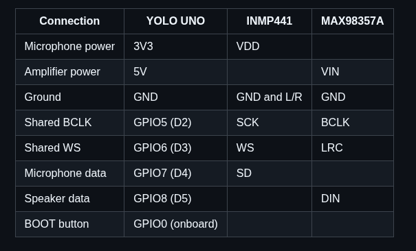
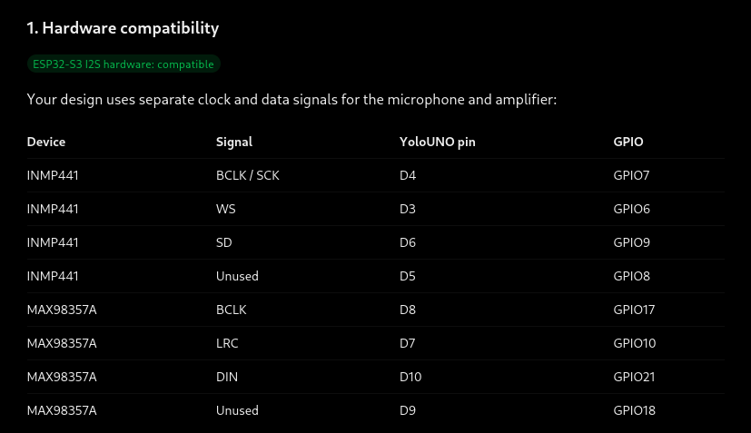

# XiaoZhi Full-Local AI Backend & Multi-Agent IoT Platform 🤖🎙️

> **Version 1.0 — AI Console & LLM Integrated Pipeline Release**  
> Complete full-local AI voice assistant backend integrated with a production-grade Multi-Agent Web Console, ThingsBoard IoT Model Context Protocol (MCP) server, and native ESP32 firmware provisioning.

Hệ thống AI Backend **hoàn toàn cục bộ (Full-Local)** phục vụ làm server xử lý hội thoại thông minh cho thiết bị **XiaoZhi ESP32**, phân bổ tài nguyên tối ưu trên phần cứng máy tính:

- 🧠 **LLM (Ollama)**: Chạy model `qwen2.5:3b-instruct` độc chiếm **GPU NVIDIA (CUDA)**, tốc độ sinh token đạt **~70 tokens/giây**.
- 👂 **STT (Faster-Whisper)**: Chạy trên **CPU** (tối ưu hóa tập lệnh AVX-512, lượng tử hóa `int8`, 4 threads, nhận diện tiếng Việt kèm VAD lọc nhiễu).
- 🗣️ **TTS (Piper)**: Chạy trên **CPU** (sinh giọng đọc tiếng Việt `vi_VN-vais1000-medium` cực nhanh, chỉ mất **~0.15s** cho câu thoại 4s).
- 🎛️ **Modern Web Console (`xiaozhi-console`)**: Dashboard React + TypeScript + Tailwind quản lý đa Agent, phòng lab IoT và kiểm thử đàm thoại trực tiếp.
- 🌉 **Platform Integration Bridge (`platform-bridge`)**: Cầu nối FastAPI (Port 8005) phục vụ giao thức manager-api, cấp phát mã kích hoạt 6 chữ số và quản lý hồ sơ Agent.
- 🔌 **ThingsBoard MCP Server (`thingsboard-mcp`)**: Server Model Context Protocol (Port 8009 SSE) giúp LLM trực tiếp truy vấn cảm biến và điều khiển thiết bị IoT.
- ⚡ **ESP32 Firmware Provisioning**: Firmware C++ tích hợp module tự kích hoạt qua mã số 6 chữ số, lưu token vào NVS và gửi heartbeat định kỳ.

---

## 📸 Hình Ảnh Minh Họa Hoạt Động (Screenshots & Architecture)

### 1. XiaoZhi Multi-Agent Management Console
Giao diện quản lý đa agent trực quan, cấu hình linh hoạt từng Agent Persona (Nova, Luna, Aero), chỉ định ThingsBoard IoT device mapping, và trò chuyện trực tiếp:


### 2. Mô Hình Kiến Trúc Tích Hợp Model Context Protocol (MCP)
Sơ đồ minh họa khái niệm XiaoZhi MCP từ bản gốc upstream ([`firmware/docs/mcp-based-graph.jpg`](firmware/docs/mcp-based-graph.jpg) — mô tả luồng lịch sử phía thiết bị và MCP đám mây; hệ thống triển khai hiện tại định tuyến qua `platform-bridge` cổng 8005 và `thingsboard-mcp`):


### 3. Sơ Đồ Đấu Nối Phần Cứng YOLO UNO & Cảm Biến Âm Thanh
Bảng sơ đồ chân I2S cho vi điều khiển YOLO UNO (ESP32-S3), microphone MEMS INMP441 và mạch khuếch đại âm thanh MAX98357A:




---

## 🏗️ Kiến Trúc Hệ Thống (Architecture)

The diagram below describes the older standalone gateway topology. In the
platform deployment, the gateway is internal and devices connect through the
bridge on port 8005.

```
[ Thiết bị XiaoZhi ESP32 ]
          │  (WebSocket: Opus Stream)
          ▼
[ XiaoZhi Gateway Server ] (Máy B Linux hoặc Cloud)
          │  (HTTP REST: OpenAI Format - 1 Port & 1 Key)
          ▼
┌─────────────────────────────────────────────────────────────┐
│  AI UNIFIED GATEWAY (Port 8080)                             │
│  Base URL: http://<IP_MAY_A>:8080/v1                        │
│  API Key : <API_KEY from .env>                          │
└────────┬──────────────────────┬──────────────────────┬──────┘
         │ /v1/chat/*           │ /v1/audio/transcribe │ /v1/audio/speech
         ▼                      ▼                      ▼
  ┌─────────────┐        ┌─────────────┐        ┌─────────────┐
  │ MCP Gateway │        │Faster-Whisper│        │  Piper-TTS  │
  │ (Port 8008) │        │ (CPU Int8)  │        │ (CPU ONNX)  │
  └──────┬──────┘        │ Port: 8000  │        │ Port: 10200 │
         │ Tool Calling  └─────────────┘        └─────────────┘
         ├──────────────┐
         ▼              ▼
  ┌─────────────┐┌─────────────┐
  │ MCP Server  ││   Ollama    │
  │ (FastMCP)   ││ (RTX GPU)   │
  │ stdio IPC   ││ Port: 11434 │
  └─────────────┘└─────────────┘
```

---

## Project index

Start here to find a workflow, the code that owns it, or the files it uses. See the [documentation index](docs/README.md) for guides and writing conventions, or [AGENTS.md](AGENTS.md) for contributor instructions.

### Workflows

| Workflow | Start here | What it uses |
| --- | --- | --- |
| Main platform and ESP32 provisioning | [Core Compose](docker-compose.yml), optionally with the [CPU override](docker-compose.cpu.yml), then [platform Compose](docker-compose.deploy.yml) | The platform bridge serves the console and proxies device WebSockets to the XiaoZhi runtime. The bridge and runtime call speech and MCP services directly. |
| React console development | [Console package](xiaozhi-console/package.json) | Vite serves the React source. The deployed bridge serves the tracked bundle under `platform-bridge/console_dist/`. |
| YOLO UNO and other ESP32 boards | [Firmware guide](firmware/README_en.md), [board definitions](firmware/main/boards/), [hardware tools](firmware/scripts/) | ESP-IDF builds using the selected board configuration. See the deployment guide for the YOLO UNO OTA fallback. [`firmware/scripts/flash.sh`](firmware/scripts/flash.sh) is a historical upstream helper targeting a hardcoded `v0.9.9_bread-compact-wifi` binary rather than local `idf.py` builds. |
| Device workbench and apartment demo | [Workbench Compose](docker-compose.simulator.yml), [apartment demo script](scripts/apartment_demo.sh) | Separate simulator workflow. The workbench receives its private device file through `DEVICE_WORKBENCH_CONFIG`. |
| Tasmota MQTT simulation and ThingsBoard RPC | [Tasmota Compose](docker-compose.tasmota.yml), [RPC contract](docs/thingsboard-rpc-contract.md), [standalone launcher](start-tasmota-sim.sh) | The simulator uses Python tools and Mosquitto. The optional ThingsBoard bridge uses the `thingsboard` profile. |
| Physical Tasmota board | [ESP32-S3 setup and customization](Tasmota/InnoLux_Tasmota_ESP32S3_Setup_Guide.md), [ThingsBoard setup](docs/tasmota-thingsboard-setup.md) | The checked-in Tasmota tree contains the hardware firmware, PlatformIO settings, and Berry script. |
| Unified gateway and laptop microphone | [Gateway implementation](gateway/server.py), [mic client](mic_test.py) | Compatibility workflow from the earlier standalone Windows gateway setup (`start_all.bat`, `run_mic_test.bat`, `scripts/init_models.bat`). Core Compose runs `gateway` on internal port 8080; `mic_test.py` requires a reachable `GATEWAY_URL`. |

### Where the code lives

| Area | Paths |
| --- | --- |
| Accounts, provisioning, console hosting, and device WebSocket proxy | [`platform-bridge/`](platform-bridge/), with [account and device setup](docs/multi-user-auth.md) |
| Console UI, API client, and assets | [`xiaozhi-console/src/`](xiaozhi-console/src/), with shared UI in [`src/components/`](xiaozhi-console/src/components/) |
| XiaoZhi server, conversation handling, and provider configuration | [`deploy/xiaozhi-runtime/`](deploy/xiaozhi-runtime/), the image source for the deployed `xiaozhi-server` container |
| LLM routing, tool calls, and legacy console | [`services/`](services/), with [`mcp_gateway.py`](services/mcp_gateway.py) as the container entry point |
| ThingsBoard integration and standalone MCP server | [`thingsboard-mcp/`](thingsboard-mcp/), with the client and tools in [`src/`](thingsboard-mcp/src/) |
| Speech-to-text and text-to-speech | [`faster-whisper/`](faster-whisper/) and [`piper/src/python_run/`](piper/src/python_run/) |
| Hardware and board-specific code | [`firmware/main/`](firmware/main/) and [`Tasmota/`](Tasmota/) |
| Device simulation and diagnostic tools | [`tools/`](tools/), plus the legacy [`platform-bridge/static_test/`](platform-bridge/static_test/) browser tester (compatibility/historical reference; not mounted alongside the React console or enabled in multi-user mode) |
| Setup and demo orchestration | [`scripts/`](scripts/), plus [`start-tasmota-sim.sh`](start-tasmota-sim.sh) and the legacy Windows compatibility launchers ([`start_all.bat`](start_all.bat), [`run_mic_test.bat`](run_mic_test.bat), [`scripts/init_models.bat`](scripts/init_models.bat)) |
| Integration tests and component tests | [`tests/`](tests/) and [`thingsboard-mcp/tests/`](thingsboard-mcp/tests/) |
| Guides, plans, and shared diagrams | [`docs/`](docs/), with component-specific docs alongside their source. Local OpenSpec work is under `openspec/`. |

### Local state and build output

| Paths | Purpose and cleanup rule |
| --- | --- |
| `.env*`, local device credential files | Private machine configuration. [`.env.example`](.env.example) is the tracked template. Keep credentials and device tokens out of Git. |
| `iot_platform_data` (`PLATFORM_DATA_VOLUME`), `deploy/xiaozhi-data/`, Docker volumes (`ollama-data`, optional `tasmota-bridge-data`, `capability-data`) | **Compose state.** `iot_platform_data` mounts at `/app/data` in `platform-bridge` (`accounts.db`, `devices.db`, `capabilities.sqlite3`, `agents.json`) and survives repo re-clones (`deploy/platform-data/` holds only pre-volume local backups/migrations). `deploy/xiaozhi-data/` mounts at `/app/data` in `xiaozhi-server` (`.config.yaml`, `.mcp_server_settings.json`). Back up persistent data before moving it. |
| `data/` | **Host data.** Default `PLATFORM_DATA_DIR` when `platform-bridge` runs directly on the host outside Docker (`accounts.db`, `devices.db`, `capabilities.sqlite3`, `agents.json`). Keep separate from the `iot_platform_data` Compose volume. |
| `agent_profile.json` | **MCP profile export.** Written in the bridge working directory by `PlatformStore.sync_to_agent_profile_json()` on agent updates and read by default by standalone `thingsboard-mcp`. Not bind-mounted into the deployed `platform-bridge` container, which passes per-agent credentials in-process. |
| `whisper-models/`, `piper-models/` | Model files mounted by the default speech services. Keep them available for the services that use them. |
| `platform-bridge/console_dist/` | Tracked console bundle served by the bridge. `xiaozhi-console/dist/` is the local fallback build. |
| `firmware/sdkconfig`, `firmware/build*/`, `firmware/managed_components/` | Local ESP-IDF configuration, build artifacts, and downloaded dependencies. Keep selected configurations, flash and provisioning images, and any local dependency edits. |
| `thingsboard/`, `xiaozhi-server/` | Local upstream trees ignored by the main repo. Preserve local source changes and outputs still referenced by a launcher or container. Separate Git metadata for local upstream trees lives in `.git/upstreams/` in this workspace. |
| `node_modules/`, Maven `target/`, frontend caches, `.git/build-cache/`, `__pycache__/` | Build and dependency locations. Check mounts, launchers, and local modifications before clearing them. The build cache under `.git/` is separate from Git's object database. |
| `.agents/`, `openspec/`, `.archify/`, local audio recordings | Local tooling, specs, generated diagrams, and recordings. Review these as individual work products before removing them. |

Put new code beside the component that owns it. Use `scripts/` for setup and orchestration, `tools/` for operator and simulator tooling, `tests/` for cross-component tests, and `docs/` for shared guides and images. Keep generated output in the owning tool's build directory and put persistent deployment state in the configured data mounts. Update this index when a workflow gains an entry point or a top-level directory.

---

## 🚀 Setup on another machine

The supported deployment targets Linux x86-64 with Docker Engine and Docker Compose (with an optional CPU-only override when no NVIDIA GPU is available). First-time installation, `.env` configuration, model downloads, native ThingsBoard dashboard setup, YOLO UNO firmware OTA fallback notes, and data backup/migration live in the canonical guide:

- [Reproduce the local deployment](docs/reproduce-deployment.md) — full step-by-step installation, verification, and backup instructions.
- [Multi-user console and device setup](docs/multi-user-auth.md) — console account creation, password resets, and ESP32 re-enrollment.
- [Documentation archive](docs/README.md#archived-deployment-guides) — earlier standalone gateway and Windows instructions kept for historical reference.

---

## ⚡ Hiệu Năng Thực Tế (Benchmark trên Ryzen 7 8845HS + RTX 3050)

| Module | Phần cứng | Model | Thời gian phản hồi | Tốc độ |
| :--- | :--- | :--- | :--- | :--- |
| **LLM (Ollama)** | GPU RTX 3050 (100% VRAM) | `qwen2.5:3b-instruct` | **0.40 giây** | **~71 tokens/s** |
| **TTS (Piper)** | CPU Ryzen (4 threads) | `vi_VN-vais1000-medium` | **0.15 giây** (cho 3.8s audio) | RTF: **0.041x** *(nhanh gấp 24 lần thời gian thực)* |
| **STT (Faster-Whisper)** | CPU Ryzen (AVX-512, int8) | `small` | **1.9 - 2.2 giây** | Chuẩn xác 100% tiếng Việt |
| **AI Gateway** | CPU Async | Reverse Proxy + Auth | **0.01 giây** | Gần như zero-latency |

---

## 📚 Tài Liệu Bổ Sung

- [Documentation index](docs/README.md)

---

## 📄 License

No repository-wide top-level `LICENSE` file has been adopted yet for the custom platform integration code in this repository (`platform-bridge/`, `xiaozhi-console/`, `thingsboard-mcp/`, `services/`, `gateway/`, `tools/`, `scripts/`). Any repository-wide license selection must be chosen explicitly because checked-in third-party components carry mixed licenses:

- **GPL-3.0**: [`Tasmota/LICENSE.txt`](Tasmota/LICENSE.txt) (with bundled library licenses under `Tasmota/lib/`).
- **MIT**: [`deploy/xiaozhi-runtime/LICENSE`](deploy/xiaozhi-runtime/LICENSE), [`deploy/xiaozhi-runtime/models/snakers4_silero-vad/LICENSE`](deploy/xiaozhi-runtime/models/snakers4_silero-vad/LICENSE), [`faster-whisper/LICENSE`](faster-whisper/LICENSE), [`firmware/LICENSE`](firmware/LICENSE), and [`piper/LICENSE.md`](piper/LICENSE.md).
