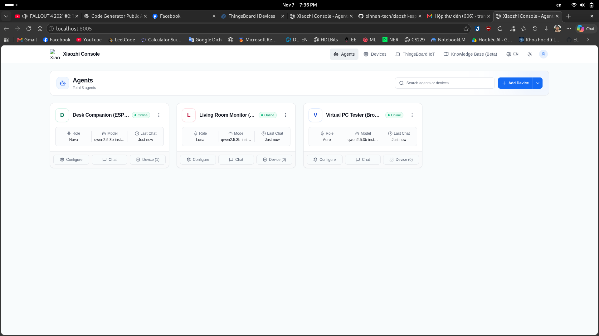
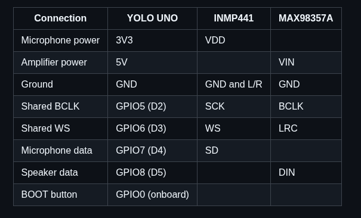
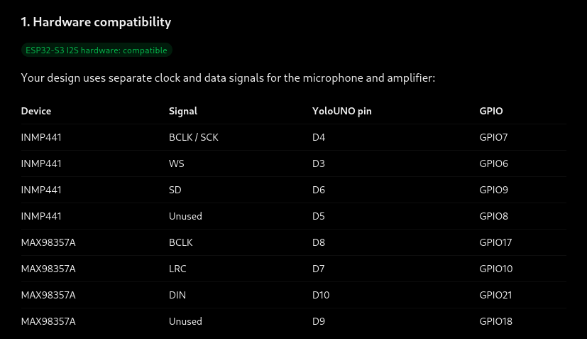

# XiaoZhi Full-Local AI Backend & Multi-Agent IoT Platform 🤖🎙️

> **Version 1.0 — AI Console & LLM Integrated Pipeline Release**  
> Complete full-local AI voice assistant backend integrated with a production-grade Multi-Agent Web Console, ThingsBoard IoT Model Context Protocol (MCP) server, and native ESP32 firmware provisioning.

Hệ thống AI Backend **hoàn toàn cục bộ (Full-Local)** phục vụ làm server xử lý hội thoại thông minh cho thiết bị **XiaoZhi ESP32**, phân bổ tài nguyên tối ưu trên phần cứng máy tính:

- 🧠 **LLM (Ollama)**: Chạy model `qwen2.5:3b-instruct` độc chiếm **GPU NVIDIA (CUDA)**, tốc độ sinh token đạt **~70 tokens/giây**.
- 👂 **STT (Faster-Whisper)**: Chạy trên **CPU** (tối ưu hóa tập lệnh AVX-512, lượng tử hóa `int8`, 4 threads, nhận diện tiếng Việt kèm VAD lọc nhiễu).
- 🗣️ **TTS (Piper)**: Chạy trên **CPU** (sinh giọng đọc tiếng Việt `vi_VN-vais1000-medium` cực nhanh, chỉ mất **~0.15s** cho câu thoại 4s).
- 🎛️ **Modern Web Console (`xiaozhi-console`)**: Dashboard React + TypeScript + Tailwind quản lý đa Agent, phòng lab IoT và kiểm thử đàm thoại trực tiếp.
- 🌉 **Platform Integration Bridge (`platform-bridge`)**: Cầu nối FastAPI (Port 8005) phục vụ giao thức manager-api, cấp phát mã kích hoạt 6 chữ số và quản lý hồ sơ Agent.
- 🔌 **ThingsBoard MCP Server (`thingsboard-mcp`)**: Server Model Context Protocol (Port 8009 SSE) giúp LLM trực tiếp truy vấn cảm biến và điều khiển thiết bị IoT.
- ⚡ **ESP32 Firmware Provisioning**: Firmware C++ tích hợp module tự kích hoạt qua mã số 6 chữ số, lưu token vào NVS và gửi heartbeat định kỳ.

---

## 📸 Hình Ảnh Minh Họa Hoạt Động (Screenshots & Architecture)

### 1. XiaoZhi Multi-Agent Management Console
Giao diện quản lý đa agent trực quan, cấu hình linh hoạt từng Agent Persona (Nova, Luna, Aero), chỉ định ThingsBoard IoT device mapping, và trò chuyện trực tiếp:


### 2. Mô Hình Kiến Trúc Tích Hợp Model Context Protocol (MCP)
Toàn bộ luồng kết nối giữa thiết bị ESP32, XiaoZhi WebSocket Server, MCP Gateway, ThingsBoard MCP và CoreIoT Platform:


### 3. Sơ Đồ Đấu Nối Phần Cứng YOLO UNO & Cảm Biến Âm Thanh
Bảng sơ đồ chân I2S cho vi điều khiển YOLO UNO (ESP32-S3), microphone MEMS INMP441 và mạch khuếch đại âm thanh MAX98357A:




---

## 🏗️ Kiến Trúc Hệ Thống (Architecture)

```
[ Thiết bị XiaoZhi ESP32 ]
          │  (WebSocket: Opus Stream)
          ▼
[ XiaoZhi Gateway Server ] (Máy B Linux hoặc Cloud)
          │  (HTTP REST: OpenAI Format - 1 Port & 1 Key)
          ▼
┌─────────────────────────────────────────────────────────────┐
│  AI UNIFIED GATEWAY (Port 8080)                             │
│  Base URL: http://<IP_MAY_A>:8080/v1                        │
│  API Key : sk-xiaozhi-local-secret                          │
└────────┬──────────────────────┬──────────────────────┬──────┘
         │ /v1/chat/*           │ /v1/audio/transcribe │ /v1/audio/speech
         ▼                      ▼                      ▼
  ┌─────────────┐        ┌─────────────┐        ┌─────────────┐
  │ MCP Gateway │        │Faster-Whisper│        │  Piper-TTS  │
  │ (Port 8008) │        │ (CPU Int8)  │        │ (CPU ONNX)  │
  └──────┬──────┘        │ Port: 8000  │        │ Port: 10200 │
         │ Tool Calling  └─────────────┘        └─────────────┘
         ├──────────────┐
         ▼              ▼
  ┌─────────────┐┌─────────────┐
  │ MCP Server  ││   Ollama    │
  │ (FastMCP)   ││ (RTX GPU)   │
  │ stdio IPC   ││ Port: 11434 │
  └─────────────┘└─────────────┘
```

---

## 📁 Cấu Trúc Thư Mục (Project Structure)

```
02_tts_stt_model/
├── docker-compose.yml          # Điều phối 5 container cơ bản (Ollama, Whisper, Piper, MCP-Gateway, Gateway)
├── docker-compose.deploy.yml   # Điều phối các dịch vụ Platform (Platform-Bridge, ThingsBoard-MCP)
├── verify_e2e_deploy.py        # Kiểm thử E2E tự động toàn bộ Platform (Bridge + MCP SSE + WebSocket Handshake)
├── start_all.bat               # Script 1-Click khởi chạy, tải model và test toàn trình trên Windows
├── run_mic_test.bat            # Script 1-Click bật trợ lý giọng nói Real-Time rảnh tay trên Laptop
├── mic_test.py                 # Trợ lý giọng nói Real-Time (Auto VAD + SSE Streaming + Context Memory)
├── init_models.bat             # Script tải model tiếng Việt & pull Qwen (Windows)
├── init_models.sh              # Script tải model tiếng Việt & pull Qwen (Linux)
├── test_pipeline.py            # Script kiểm thử Round-Trip (LLM -> TTS -> STT -> Gateway)
├── test_mcp_flow.py            # Script kiểm thử tự động MCP Tool Calling & Direct LLM
├── HANDOFF.md                  # Tài liệu bàn giao kỹ thuật toàn trình (Full System Handoff)
├── XIAOZHI_CONFIG.md           # Mẫu cấu hình XiaoZhi Server (YAML & JSON)
├── DEPLOY_MACHINE_B.md         # Hướng dẫn kết nối từ máy Linux khác
├── DEPLOY_AWS.md               # Hướng dẫn đưa toàn bộ hệ thống lên máy chủ AWS EC2
│
├── xiaozhi-console/            # Frontend Web Console (React + TypeScript + Tailwind + Lucide)
├── platform-bridge/            # Platform Bridge FastAPI Server (Port 8005) & Embedded Console Dist
├── thingsboard-mcp/            # Dedicated ThingsBoard Model Context Protocol (MCP) Server (Port 8009)
├── firmware/                   # Mã nguồn C++ ESP32 firmware với platform provisioning & NVS
├── docs/                       # Tài liệu chi tiết & Đặc tả kỹ thuật (Spec Alpha 0.2, hình ảnh minh họa)
│   ├── spec-alpha-0.2.md
│   └── images/                 # Ảnh chụp màn hình và sơ đồ hệ thống
├── tests/                      # Bộ kiểm thử tự động (Unit & Integration)
│   ├── test_alpha02_provisioning.py
│   ├── test_alpha_console_integration.py
│   ├── test_phase1b_dual_device.py
│   └── test_virtual_pc_profile.py
├── services/                   # Module MCP Agent Gateway & MCP Server
│   ├── Dockerfile
│   ├── requirements.txt
│   ├── mcp_gateway.py          # FastAPI Gateway điều phối Tool Calling với Ollama
│   └── mcp_server.py           # FastMCP Server định nghĩa tools (Time GMT+7, Weather, Device)
├── gateway/                    # Mã nguồn Unified AI Gateway (Port 8080)
│   ├── Dockerfile
│   └── server.py
├── faster-whisper/             # CTranslate2 STT Server tương thích OpenAI
│   ├── Dockerfile.cpu
│   └── server.py
├── piper/                      # Piper TTS Engine
│   └── src/python_run/
│       ├── Dockerfile
│       └── server.py
├── piper-models/               # (Git ignored) Chứa voice ONNX tiếng Việt
└── whisper-models/             # (Git ignored) Cache model Whisper small int8
```

---

## 🚀 Khởi Chạy Nhanh (Quick Start)

### Trên Windows:
1. Đảm bảo **Docker Desktop** đang chạy (icon màu xanh lá).
2. Double-click chạy file:
   ```cmd
   start_all.bat
   ```
3. Script sẽ tự khởi chạy container, kiểm tra model và in ra địa chỉ IP LAN cùng mẫu config để dán vào XiaoZhi Server.
4. **Đàm thoại Real-Time trực tiếp trên Laptop (Rảnh tay 100%):**
   - Nhấp đúp `run_mic_test.bat` hoặc chạy `python mic_test.py` (cần `pip install sounddevice numpy`).
   - Tự động cân chỉnh độ ồn nền (VAD), nhớ ngữ cảnh đa lượt (`chat_history`), và stream từng câu từ LLM sang TTS giúp phát âm thanh đầu tiên chỉ sau **~0.66 giây**.

### Trên Linux / macOS:
```bash
# 1. Khởi chạy các container
docker compose up -d --build

# 2. Tải model tiếng Việt & LLM
chmod +x init_models.sh
./init_models.sh

# 3. Kiểm thử toàn trình
python3 test_pipeline.py
```

---

## 🔌 Cấu Hình Cho XiaoZhi Server

Dán cấu hình sau vào `config.yaml` của **XiaoZhi ESP32 Server**:

```yaml
selected_module:
  ASR: OpenAIASR
  LLM: OpenAILLM
  TTS: OpenAITTS

ASR:
  OpenAIASR:
    type: openai
    base_url: http://<IP_MAY_A>:8080/v1
    api_key: sk-xiaozhi-local-secret
    model_name: small
    language: vi

LLM:
  OpenAILLM:
    type: openai
    base_url: http://<IP_MAY_A>:8080/v1
    api_key: sk-xiaozhi-local-secret
    model_name: qwen2.5:3b-instruct

TTS:
  OpenAITTS:
    type: openai
    api_url: http://<IP_MAY_A>:8080/v1/audio/speech
    api_key: sk-xiaozhi-local-secret
    model: tts-1
    voice: vi_VN-vais1000-medium
```

---

## ⚡ Hiệu Năng Thực Tế (Benchmark trên Ryzen 7 8845HS + RTX 3050)

| Module | Phần cứng | Model | Thời gian phản hồi | Tốc độ |
| :--- | :--- | :--- | :--- | :--- |
| **LLM (Ollama)** | GPU RTX 3050 (100% VRAM) | `qwen2.5:3b-instruct` | **0.40 giây** | **~71 tokens/s** |
| **TTS (Piper)** | CPU Ryzen (4 threads) | `vi_VN-vais1000-medium` | **0.15 giây** (cho 3.8s audio) | RTF: **0.041x** *(nhanh gấp 24 lần thời gian thực)* |
| **STT (Faster-Whisper)** | CPU Ryzen (AVX-512, int8) | `small` | **1.9 - 2.2 giây** | Chuẩn xác 100% tiếng Việt |
| **AI Gateway** | CPU Async | Reverse Proxy + Auth | **0.01 giây** | Gần như zero-latency |

---

## 📚 Tài Liệu Bổ Sung

- [DEPLOY_MACHINE_B.md](DEPLOY_MACHINE_B.md): Hướng dẫn kết nối từ máy Linux làm XiaoZhi Server qua mạng LAN.
- [DEPLOY_AWS.md](DEPLOY_AWS.md): Hướng dẫn đưa toàn bộ cụm AI lên máy ảo AWS EC2 `g4dn.xlarge` kèm SSL WSS.
- [XIAOZHI_CONFIG.md](XIAOZHI_CONFIG.md): Chi tiết các định dạng cấu hình YAML / JSON.

---

## 📄 License
Dự án được phân phối dưới giấy phép [MIT](LICENSE).
