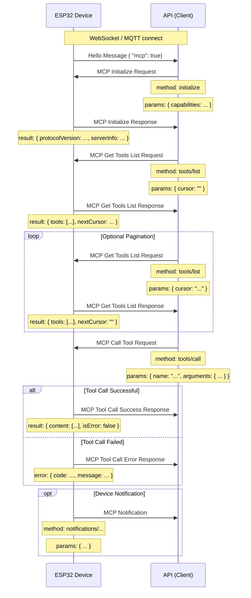

# MCP (Model Context Protocol) 

NOTICE: AI , service, !!

 MCP  API (MCP client)  ESP32 device (MCP service) , calldevice (tool) . 

## 

 (`main/protocols/protocol.cc`, `main/mcp_server.cc`), MCP message ( WebSocket  MQTT) message.  [JSON-RPC 2.0](https://www.jsonrpc.org/specification) . 

message: 

```json
{
  "session_id": "...", //  ID
  "type": "mcp",       // messagetype,  "mcp"
  "payload": {         // JSON-RPC 2.0 
    "jsonrpc": "2.0",
    "method": "...",   //  ( "initialize", "tools/list", "tools/call")
    "params": { ... }, // param ( request)
    "id": ...,         //  ID ( request  response)
    "result": { ... }, //  ( success response)
    "error": { ... }   // Error message ( error response)
  }
}
```

, `payload`  JSON-RPC 2.0 message: 

- `jsonrpc`:  "2.0". 
- `method`: callname ( Request). 
- `params`: param, ,  ( Request). 
- `id`: , clientsend, servicereturn. . 
- `result`: success ( Success Response). 
- `error`: failedError message ( Error Response). 

## send

MCP client ( API) calldevice"tool" (Tool) . 

1.  **connect**

    - **: ** devicesuccessconnect API . 
    - **send: ** device. 
    - **message: ** devicesend "hello" message API, messagedevicesupport, support MCP  (`"mcp": true`). 
    - ** ( MCP , message):**
      ```json
      {
        "type": "hello",
        "version": ...,
        "features": {
          "mcp": true,
          ...
        },
        "transport": "websocket", //  "mqtt"
        "audio_params": { ... },
        "session_id": "..." // deviceservicehelloset
      }
      ```

2.  **initialize MCP **

    - **: **  API device "hello" message, devicesupport MCP ,  MCP send. 
    - **send: **  API (client). 
    - **: ** `initialize`
    - **message (MCP payload):**

      ```json
      {
        "jsonrpc": "2.0",
        "method": "initialize",
        "params": {
          "capabilities": {
            // client, 

            "vision": {
              "url": "...", //: processaddress(httpaddress, websocketaddress)
              "token": "..." // url token
            }

            // ... client
          }
        },
        "id": 1 //  ID
      }
      ```

    - **device: ** device `initialize` process. 
    - **devicemessage (MCP payload):**
      ```json
      {
        "jsonrpc": "2.0",
        "id": 1, //  ID
        "result": {
          "protocolVersion": "2024-11-05",
          "capabilities": {
            "tools": {} //  tools ,  tools/list
          },
          "serverInfo": {
            "name": "...", // devicename (BOARD_NAME)
            "version": "..." // deviceversion
          }
        }
      }
      ```

3.  **devicetool**

    - **: **  API getdevicesupport (tool) call. 
    - **send: **  API (client). 
    - **: ** `tools/list`
    - **message (MCP payload):**
      ```json
      {
        "jsonrpc": "2.0",
        "method": "tools/list",
        "params": {
          "cursor": "" // , 
        },
        "id": 2 //  ID
      }
      ```
    - **device: ** device `tools/list` tool. 
    - **devicemessage (MCP payload):**
      ```json
      {
        "jsonrpc": "2.0",
        "id": 2, //  ID
        "result": {
          "tools": [ // tool
            {
              "name": "self.get_device_status",
              "description": "...",
              "inputSchema": { ... } // param schema
            },
            {
              "name": "self.audio_speaker.set_volume",
              "description": "...",
              "inputSchema": { ... } // param schema
            }
            // ... tool
          ],
          "nextCursor": "..." // ,  cursor 
        }
      }
      ```
    - **process: **  `nextCursor` field, clientsend `tools/list` ,  `params`  `cursor` gettool. 

4.  **calldevicetool**

    - **: **  API device. 
    - **send: **  API (client). 
    - **: ** `tools/call`
    - **message (MCP payload):**
      ```json
      {
        "jsonrpc": "2.0",
        "method": "tools/call",
        "params": {
          "name": "self.audio_speaker.set_volume", // calltoolname
          "arguments": {
            // toolparam, 
            "volume": 50 // param
          }
        },
        "id": 3 //  ID
      }
      ```
    - **device: ** device `tools/call` , tool. 
    - **devicesuccessmessage (MCP payload):**
      ```json
      {
        "jsonrpc": "2.0",
        "id": 3, //  ID
        "result": {
          "content": [
            // tool
            { "type": "text", "text": "true" } // : set_volume return bool
          ],
          "isError": false // success
        }
      }
      ```
    - **devicefailedmessage (MCP payload):**
      ```json
      {
        "jsonrpc": "2.0",
        "id": 3, //  ID
        "error": {
          "code": -32601, // JSON-RPC Error,  Method not found (-32601)
          "message": "Unknown tool: self.non_existent_tool" // Errordescription
        }
      }
      ```

5.  **devicesendmessage (Notifications)**
    - **: ** device API  (, status, toolsendmessage,  `Application::SendMcpMessage` devicesend MCP message) . 
    - **send: ** device (service). 
    - **: **  `notifications/` , . 
    - **message (MCP payload):**  JSON-RPC Notification ,  `id` field. 
      ```json
      {
        "jsonrpc": "2.0",
        "method": "notifications/state_changed", // 
        "params": {
          "newState": "idle",
          "oldState": "connecting"
        }
        //  id field
      }
      ```
    - ** API process: ** receive Notification ,  API process, . 

## 

,  MCP message: 



 MCP . paramtool `main/mcp_server.cc`  `McpServer::AddCommonTools` tool. 
