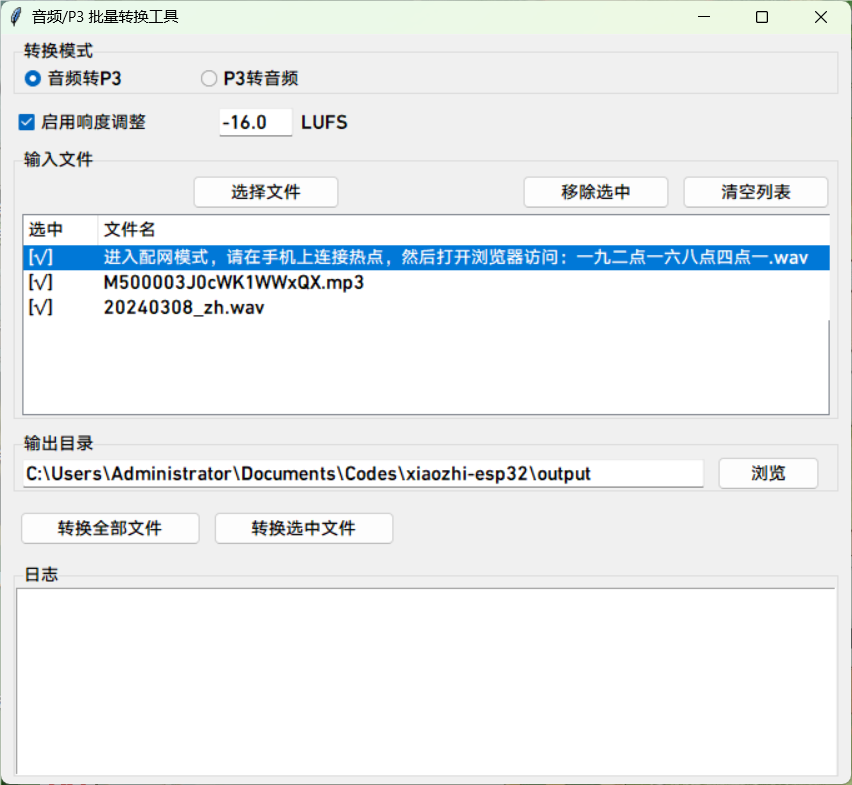

# P3audiotool

directoryprocessP3audiofilePython: 

## 1. audiotool (convert_audio_to_p3.py)

audiofileP3 (4header + Opusdatastreaming) . 

### use

```bash
python convert_audio_to_p3.py <audiofile> <P3file> [-l LUFS] [-d]
```

,  `-l` , default -16 LUFS;  `-d` . 

audiofile, use `-d` : 
- audio
- audio
- audiodefault TTS  (use TTS default -16 LUFS) 

: 
```bash
python convert_audio_to_p3.py input.mp3 output.p3
```

## 2. P3audiotool (play_p3.py)

P3audiofile. 

### 

- P3audiofile
- enduser, 
- supportparamfile

### use

```bash
python play_p3.py <P3file>
```

: 
```bash
python play_p3.py output.p3
```

## 3. audiotool (convert_p3_to_audio.py)

P3audiofile. 

### use

```bash
python convert_p3_to_audio.py <P3file> <audiofile>
```

audiofile. 

: 
```bash
python convert_p3_to_audio.py input.p3 output.wav
```
## 4. audio/P3tool

tool, supportaudioP3, P3audio



### use: 
```bash
python batch_convert_gui.py
```

## 

use, Python: 

```bash
pip install librosa opuslib numpy tqdm sounddevice pyloudnorm soundfile
```

userequirements.txtfile: 

```bash
pip install -r requirements.txt
```

## P3

P3streamingaudio, : 
- audio4Opusdata
- : [1type, 1, 2]
- 16000Hz, 
- 60ms 